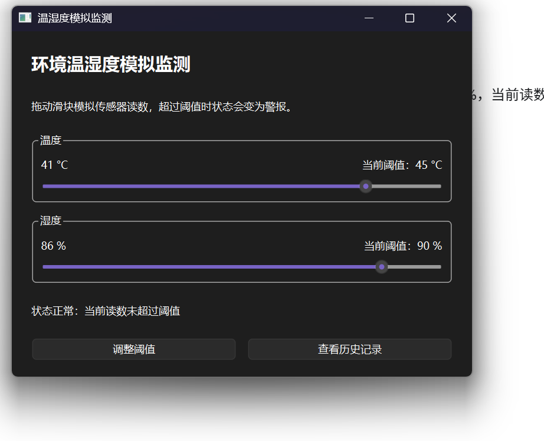
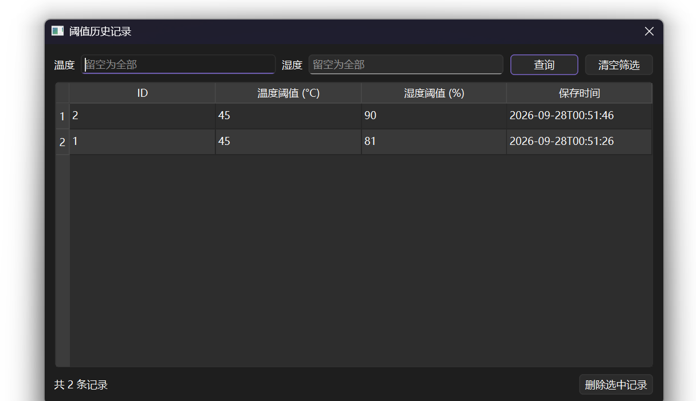

# Qt 6 Environment Monitor

A small C++17 / Qt Widgets desktop application for **simulated** temperature and humidity monitoring. Sliders stand in for sensor readings; this project does not connect to physical hardware.

## Features

- Simulate temperature (0–50 °C) and humidity (0–100%).
- Set alarm thresholds with bounded numeric inputs. The status updates immediately without repeated modal alerts while dragging a slider.
- Save thresholds to SQLite and restore the latest saved values on restart.
- Filter threshold history by temperature or humidity and delete a selected record after confirmation.
- Keep SQL operations in `ThresholdStore` and use bound parameters for searches and deletes.

## Build and run / 在 Qt Creator 中运行

1. Open [`03_test.pro`](03_test.pro) in Qt Creator.
2. Select a **Desktop Qt 6 MinGW 64-bit** kit. This project was built with Qt 6.11.2 and MinGW 13.1 on Windows 11.
3. Click **Configure Project**, then **Run**.

The application requires the Qt Widgets and Qt SQL modules plus the SQLite driver (`QSQLITE`). The `.ui` files are editable XML forms in Qt Designer.

## Code layout

| File | Purpose |
| --- | --- |
| `widget.*`, `widget.ui` | Main window, sliders, status display, dialog navigation |
| `setdialog.*`, `setdialog.ui` | Threshold input dialog |
| `historydialog.*`, `historydialog.ui` | History search and deletion |
| `thresholdstore.*` | SQLite schema and queries |
| `monitorlogic.h` | Threshold comparison |
| `tests/` | Qt Test checks for threshold logic and SQLite operations |

## Data and verification

The app stores `env.db` in Qt's `AppDataLocation`, so switching Debug/Release build directories does not change the active database. If a legacy `env.db` is found in the current working directory or beside the executable on first run, the app attempts to copy it. Otherwise it starts with defaults of **30 °C / 80%**. Personal database files and build products are ignored by Git.

To run the automated checks, open `tests/tests.pro` as a separate Qt Creator project and use the same desktop kit. On Qt 6.11.2, the local Qt Test run reported **5 passed, 0 failed** (including setup and cleanup). The application was also opened in Qt Creator and manually checked for single and combined alarms, threshold changes, and history writes.

## Scope

This is a desktop simulation and learning project. It does not include sensor hardware integration, live telemetry, or installer packaging.
